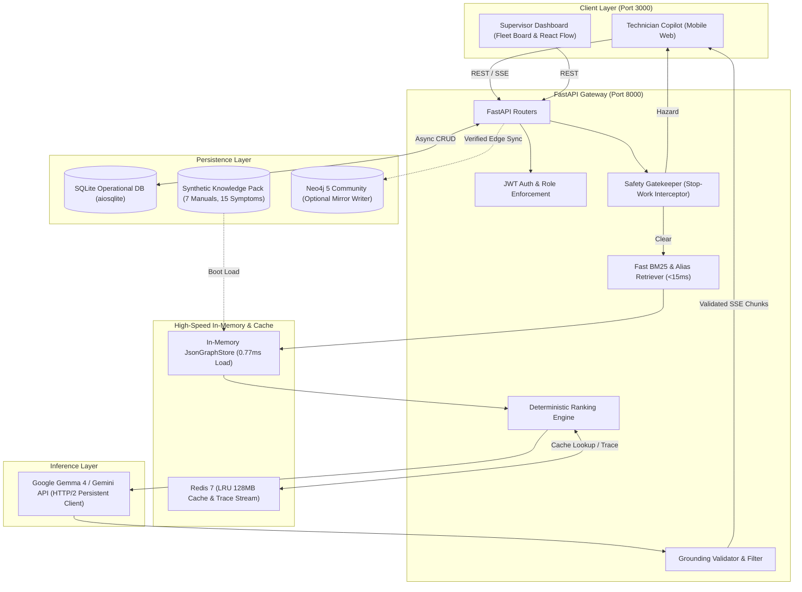

# ⚙️ Readiness Assistant

[](https://fastapi.tiangolo.com/)
[](https://react.dev/)
[](https://www.sqlite.org/)
[](https://redis.io/)
[](https://neo4j.com/)
[](https://ai.google.dev/)

> ** Safety Notice:** This repository contains a demonstration platform loaded with synthetic industrial maintenance data. It is **not** certified for live safety-critical decisions, lock-out/tag-out (LOTO) execution, or hazardous equipment operation.

**Readiness Assistant** is an AI-powered equipment reliability and maintenance intelligence platform engineered for industrial rotating machinery (**centrifugal pumps** and **induction motors**). It helps field technicians isolate faults safely, helps maintenance managers prioritize work orders, and helps industrial facilities prevent avoidable downtime.

###  Core Promise
> *"The right maintenance knowledge, for the right equipment, at the moment a fault occurs—with evidence behind every recommendation."*

Unlike generic RAG chatbots that retrieve isolated manual paragraphs, **Readiness Assistant** governs the complete operational maintenance loop:

$$\text{Symptom} \longrightarrow \text{Evidence-Ranked Diagnosis} \longrightarrow \text{Verified Action} \longrightarrow \text{Maintenance Record} \longrightarrow \text{Prevention}$$

---

##  Table of Contents
1. [The Problem Worth Solving](#-the-problem-worth-solving)
2. [System Architecture](#-system-architecture)
3. [Six Core Product Capabilities](#-six-core-product-capabilities)
4. [Epistemic Trust, Safety & Ranking Engine](#-epistemic-trust-safety--ranking-engine)
5. [Knowledge Graph & Data Architecture](#-knowledge-graph--data-architecture)
6. [Signature End-to-End Workflow](#-signature-end-to-end-workflow)
7. [Repository Structure](#-repository-structure)
8. [Quickstart & Installation](#-quickstart--installation)
9. [API Reference](#-api-reference)
10. [3-Step Live Demo Script](#-3-step-live-demo-script)
11. [Product Roadmap & SaaS Evolution](#-product-roadmap--saas-evolution)

---

##  The Problem Worth Solving

In small and mid-sized industrial facilities, critical maintenance intelligence is fragmented across incompatible silos:
* **Unstructured Documentation:** Multi-hundred-page OEM PDF manuals, electrical schematics, and revision-specific service bulletins.
* **Informal Tribal Memory:** Veteran technicians' personal experience, paper shift logs, spreadsheets, and unindexed WhatsApp threads.
* **Disconnected Records:** Work orders, inspection checklists, and spare-parts catalogs that do not feed back into future troubleshooting.
* **Revision Drift:** Different safety tolerances and diagnostic procedures across equipment models and manual revisions.

When a critical pump or motor faults on the shop floor, a technician must locate the exact manual revision, cross-reference symptoms against possible failure modes, verify safe operating boundaries, and log findings. **Readiness Assistant** unifies these steps into an evidence-linked workflow where **every recommendation is traceable to an approved source or supervisor-verified historical repair**.

---

##  System Architecture

The platform pairs a low-latency, deterministic retrieval and ranking core (`<15ms` BM25 + `0.77ms` in-memory graph load) with an HTTP/2 streaming LLM synthesis layer protected by pre-inference safety interceptors and post-inference citation gates.



### Subsystem Performance & Engineering Highlights

| Subsystem | Technology | Latency / Spec | Core Responsibility |
| :--- | :--- | :--- | :--- |
| **In-Memory Graph Store** | Python `JsonGraphStore` | **0.77ms** cold load | Loads the 7-manual, 15-symptom equipment ontology into RAM at startup for zero-I/O multi-hop traversal. |
| **Lexical & Alias Retriever** | Fast BM25 + Domain Synonym Map | **<15ms** query time | Maps colloquial technician phrasing (e.g., *"running hot"*, *"growling bearing"*) to canonical graph symptom IDs and manual chunks. |
| **Safety Gatekeeper** | Deterministic Rule Interceptor | **<2ms** pre-LLM | Intercepts critical hazards (arc flash risk, thermal runaway, missing LOTO clearance) and immediately returns mandatory shutdown procedures without waiting for LLM generation. |
| **Cache & Trace Bus** | Redis 7 (`128MB` `allkeys-lru`) | **<1ms** cache hit | Caches deterministic ranking outputs and streams live diagnostic execution traces to the Supervisor Dashboard. |
| **Inference Client** | Google Gemini / Gemma 4 API | HTTP/2 Multiplexed | Persistent connection pool streaming structured diagnostic steps constrained to retrieved manual passages. |
| **Grounding Validator** | Post-Generation Citation Filter | Real-time SSE gate | Verifies that every emitted procedure ID, page citation, and tolerance value exists in the retrieved context before forwarding SSE chunks to the client. |
| **Operational Store** | SQLite (`aiosqlite`) + Neo4j 5 | Async Non-Blocking | Persists state-machine sessions, technician observations, work orders, and audit logs; optionally mirrors verified repair edges to Neo4j 5 Community. |

---

##  Six Core Product Capabilities

These six capabilities operate as integrated modules sharing the same equipment registry, knowledge graph, and operational database:

### 1. Troubleshooting Copilot (`Core MVP`)
Field technicians describe a fault in plain language, attach an alarm code or inspection photo, and receive ranked candidate causes, role-appropriate diagnostic checks, stop-work warnings, and exact manual citations.

### 2. Equipment Knowledge Graph (`Core Differentiator`)
Connects **Equipment $\rightarrow$ Components $\rightarrow$ Symptoms $\rightarrow$ Fault Codes $\rightarrow$ Possible Causes $\rightarrow$ Approved Procedures $\rightarrow$ Spare Parts $\rightarrow$ Verified Outcomes**. Rendered interactively via **React Flow** so technicians and supervisors can inspect *why* a recommendation was surfaced.

### 3. Digital Maintenance Workflows (`Human-in-the-Loop`)
Converts an active troubleshooting session directly into an inspection checklist or draft work order with assigned technician, priority, required spare parts, and measured findings. **Hard Guardrail:** The AI can never automatically transition an asset to `READY` or mark a work order as `VERIFIED_CLOSED`.

### 4. Maintenance Memory (`Closed-Loop Learning`)
When a job is completed and approved by a supervisor, the symptoms, confirmed root cause, executed procedure, and replaced part SKU are written back into the Knowledge Graph as a `VERIFIED` historical incident—enriching future diagnostics without polluting the knowledge base with unverified chat transcripts.

### 5. Readiness & Risk Monitor (`Fleet Board`)
Provides maintenance managers with a real-time operational status board across all rotating assets (`READY`, `DEGRADED`, `HOLD_FOR_INSPECTION`, `LOCKED_OUT`), explaining why an asset is flagged, what measurements are missing, and who must authorize return-to-service.

### 6. Recurring Fault Intelligence (`Reliability Analytics`)
Identifies chronic failure patterns, high-velocity component replacements, and repeated unresolved symptoms across identical pump/motor models using deterministic frequency and time-window analytics.

---

##  Epistemic Trust, Safety & Ranking Engine

Industrial users do not trust opaque AI confidence percentages (e.g., *"87% confident"*). **Readiness Assistant** replaces arbitrary probabilities with explicit **Epistemic Provenance Labels** and a **Deterministic Ranking Formula**.

### The Four Epistemic Labels

Every diagnostic card, graph edge, and procedural step in the UI carries one of four strict epistemic badges:

| Badge | Label | Definition & Provenance Requirement |
| :--- | :--- | :--- |
|  | **`DOCUMENTED`** | Explicitly stated in an applicable OEM manual, service bulletin, or electrical schematic (includes `doc_id`, `revision`, `page`, and `section`). |
|  | **`OBSERVED`** | Recorded directly by a technician or calibrated instrument during an active or historical inspection (e.g., `88.5°C` bearing housing temperature). |
|  | **`INFERRED`** | A candidate hypothesis generated by matching reported symptoms against the Knowledge Graph topology; requires physical verification before repair. |
|  | **`VERIFIED`** | Confirmed through an approved diagnostic procedure, physical repair, and explicit supervisor sign-off in a closed work order. |

### Deterministic Evidence Ranking Formula

Before invoking the Gemini/Gemma 4 inference layer, the **Deterministic Ranking Engine** scores every candidate cause $c$ connected to the reported symptom set $Q$ on asset $a$ (of equipment model $m$):

$$S(c, a, Q) = w_{\text{cov}} \left( \frac{\vert{}Symptoms(c) \cap Q\vert{}}{\vert{}Q\vert{}} \right) + w_{\text{doc}} \cdot P_{\text{OEM}}(c) + w_{\text{bm25}} \cdot \hat{B}(c, Q) + w_{\text{asset}} \cdot \ln\left(1 + N_{\text{verified}}(c, a)\right) + w_{\text{fleet}} \cdot \ln\left(1 + N_{\text{verified}}(c, m)\right)$$

Where:
* $\frac{\vert{}Symptoms(c) \cap Q\vert{}}{\vert{}Q\vert{}}$: **Symptom Coverage Ratio**—proportion of reported symptoms explained by candidate cause $c$.
* $P_{\text{OEM}}(c) \in [0, 1]$: **OEM Prior Weight** defined in the manufacturer's fault isolation matrix (`DOCUMENTED`).
* $\hat{B}(c, Q) \in [0, 1]$: **Normalized BM25 Lexical & Alias Score** across associated manual passages.
* $N_{\text{verified}}(c, a)$: Count of supervisor-approved `VERIFIED` incidents for cause $c$ on this exact serial asset $a$.
* $N_{\text{verified}}(c, m)$: Count of `VERIFIED` incidents for cause $c$ across all assets sharing equipment model $m$.

Causes are categorized into transparent evidence bands:
* **High Evidence Fit** ($S \ge 0.75$)
* **Moderate Evidence Fit** ($0.45 \le S < 0.75$)
* **Low / Hypothesis Only** ($S < 0.45$)

---

## 🕸️ Knowledge Graph & Data Architecture

### Graph Schema (`JsonGraphStore` & `Neo4j 5`)

```
(Equipment {asset_id, tag, manufacturer, model, manual_rev})
   │
   ├──[:HAS_COMPONENT {epistemic: "DOCUMENTED"}]──> (Component {comp_id, name, part_sku})
   │                                                    │
   │                                                    └──[:EXHIBITS_SYMPTOM]──> (Symptom {sym_id, name, aliases[], alarm_codes[]})
   │                                                                                   │
   │                                  ┌────────────────────────────────────────────────┘
   │                                  │ [:POSSIBLY_INDICATES {base_weight, doc_id, page, rev, epistemic: "DOCUMENTED"}]
   │                                  ▼
   │                           (PossibleCause {cause_id, name, failure_mode})
   │                                  │
   │                                  └──[:INVESTIGATED_BY {req_role, loto_required}]──> (ApprovedProcedure {proc_id, steps[], limits, stop_work})
   │
   └──[:HAS_HISTORY]──> (VerifiedOutcome {inc_id, wo_id, observed_metrics, verified_by, timestamp})
                                  │
                                  ├──[:CONFIRMED_CAUSE {epistemic: "VERIFIED"}]──> (PossibleCause)
                                  └──[:EXECUTED_PROCEDURE]──> (ApprovedProcedure)
```

### Synthetic Knowledge Pack (`data/knowledge_pack/`)
Out of the box, the repository includes a curated industrial dataset covering:
* **7 Equipment Manuals & Service Bulletins:** Covering 3-phase squirrel-cage induction motors (`415V`, `15kW–75kW`) and end-suction centrifugal process pumps (seal flush systems, impeller clearances, alignment tolerances, bearing lubrication schedules).
* **15 Canonical Symptoms & 60+ Field Aliases:** Including winding overheating, high radial/axial vibration, mechanical seal leakage, cavitation noise, phase unbalance, low discharge head, and thermal overload trips.
* **Traceable Provenance Metadata:** Every edge stores `source_doc_id`, `page_number`, `section_heading`, `applicable_models`, `manual_revision`, and `effective_date`.

---

##  Signature End-to-End Workflow

**Scenario:** Field technician reports on **Induction Motor M-104**:  
> *"Motor temperature is rising, vibration is above normal, and the machine is losing performance."*

1. **Identify the Asset:** Router resolves `M-104` against SQLite to bind manufacturer, model (`KEC-415V-30KW`), active manual revision (`Rev-3.2`), and technician clearance level (`TECH_L2`).
2. **Assess Immediate Risk (`Safety Gatekeeper`):** Evaluates input against thermal/electrical hazard rules. Prompts for active alarm codes and surfaces the approved LOTO isolation procedure if surface temperature exceeds `95°C` or smoke/insulation odor is present.
3. **Rank Possible Causes (`BM25 + JsonGraphStore + Ranking Engine`):** Retrieves matching subgraphs in `<15ms` and ranks candidate causes:
   * `#1 Drive-End Bearing Wear / Lubrication Degradation` (*Moderate-High Evidence Fit* — matches overheating + radial vibration + 2 prior verified incidents).
   * `#2 Shaft-to-Pump Coupling Misalignment` (*Moderate Evidence Fit*).
   * `#3 Cooling Fan Cowl Obstruction` (*Low / Hypothesis — explains overheating, does not explain vibration*).
4. **Guide the Next Safe Check:** Streams grounded instructions from `SOP-M104-08 (Page 44, Rev-3.2)` with expected normal limits (`<4.5 mm/s RMS`, `<80°C`) and escalation criteria.
5. **Capture the Finding:** Technician performs the check and records `88.5°C` housing temperature and metallic grease contamination. Stored in SQLite as `epistemic_label = OBSERVED`.
6. **Close the Loop (`Supervisor Approval`):** Converts session into a draft work order (`SKF-6312-2Z` bearing replacement). Once the supervisor verifies the completed repair, the asset status transitions from `HOLD_FOR_INSPECTION` to `READY`, and a new `VERIFIED` edge is committed to `JsonGraphStore` and `Neo4j`.

---

##  Repository Structure

```text
readiness-assistant/
├── backend/
│   ├── app/
│   │   ├── main.py                  # FastAPI application entrypoint & lifespan hooks
│   │   ├── config.py                # Pydantic Settings (env vars, Redis, Neo4j, Gemini)
│   │   ├── auth/
│   │   │   └── jwt_rbac.py          # JWT authentication & role/LOTO clearance guards
│   │   ├── api/
│   │   │   ├── routes_copilot.py    # REST & SSE diagnostic streaming endpoints
│   │   │   ├── routes_workflows.py  # Observations, draft work orders & supervisor sign-off
│   │   │   ├── routes_fleet.py      # Readiness monitor, risk scoring & recurring faults
│   │   │   └── routes_graph.py      # React Flow subgraph & provenance endpoints
│   │   ├── engine/
│   │   │   ├── safety_gate.py       # Pre-LLM stop-work & hazard interceptor
│   │   │   ├── bm25_retriever.py    # <15ms lexical & colloquial alias retriever
│   │   │   ├── json_graph_store.py  # 0.77ms in-memory graph loader & traversal engine
│   │   │   ├── ranker.py            # Deterministic evidence scoring formula
│   │   │   └── grounding_filter.py  # Post-LLM citation & epistemic label validator
│   │   ├── llm/
│   │   │   └── gemini_client.py     # Persistent HTTP/2 client for Gemini / Gemma 4
│   │   └── db/
│   │       ├── sqlite_store.py      # Async SQLite (aiosqlite) schema & CRUD operations
│   │       ├── redis_cache.py       # Redis 7 128MB LRU cache & trace pub/sub
│   │       └── neo4j_mirror.py      # Optional async Neo4j 5 Community mirror writer
│   ├── data/
│   │   └── knowledge_pack/          # 7 synthetic manuals, 15 symptoms, graph.json & seed SQL
│   ├── tests/                       # Pytest suite (safety gate, determinism, grounding)
│   └── requirements.txt
├── frontend/
│   ├── src/
│   │   ├── components/
│   │   │   ├── copilot/             # Symptom input, SSE stream viewer, Epistemic badges
│   │   │   ├── graph/               # React Flow interactive provenance explorer
│   │   │   ├── workflows/           # Inspection checklist & work-order approval modals
│   │   │   └── supervisor/          # Fleet Readiness Board & Recurring Fault analytics
│   │   ├── hooks/                   # SSE stream hooks & offline cache state
│   │   └── App.tsx
│   ├── package.json
│   └── vite.config.ts               # Configured for Port 3000 + API proxy to Port 8000
├── docker-compose.yml               # Orchestrates FastAPI, React, Redis 7, and Neo4j 5
├── .env.example
└── README.md
```

---

##  Quickstart & Installation

### Prerequisites
* **Python:** `3.11+`
* **Node.js:** `20+` (with `npm` or `pnpm`)
* **Redis:** `7.x` (optional for local dev; falls back to in-memory LRU if unavailable)
* **Neo4j:** `5.x Community` (optional; `JsonGraphStore` runs standalone in memory)
* **Google AI API Key:** Access to Gemini / Gemma 4 via Google AI Studio or Vertex AI

### 1. Clone & Configure Environment

```bash
git clone [https://github.com/your-org/readiness-assistant.git](https://github.com/your-org/readiness-assistant.git)
cd readiness-assistant
cp .env.example .env
```

Edit `.env` with your configuration:

```ini
# Application & Security
APP_ENV=development
JWT_SECRET_KEY=super-secret-industrial-signing-key-change-me
ALLOWED_ORIGINS=http://localhost:3000

# Inference Layer (Google Gemini / Gemma 4)
GEMINI_API_KEY=your_google_gemini_api_key_here
GEMINI_MODEL_ID=gemini-2.5-flash

# Storage & Knowledge Pack
SQLITE_DB_PATH=./backend/data/readiness_operational.db
KNOWLEDGE_PACK_PATH=./backend/data/knowledge_pack/graph.json

# High-Speed Cache (Redis 7)
REDIS_URL=redis://localhost:6379/0
REDIS_MAXMEMORY_POLICY=allkeys-lru

# Optional Graph Mirror (Neo4j 5 Community)
NEO4J_ENABLED=false
NEO4J_URI=bolt://localhost:7687
NEO4J_USER=neo4j
NEO4J_PASSWORD=readiness_graph_pass
```

### 2. Option A: Run with Docker Compose (Recommended)

Starts the **Client UI (Port 3000)**, **FastAPI Gateway (Port 8000)**, **Redis 7 (128MB LRU)**, and **Neo4j 5 Community**:

```bash
docker compose up --build
```

### 3. Option B: Run Locally for Development

**Terminal 1 — Start FastAPI Backend (Port 8000):**
```bash
cd backend
python -m venv .venv
source .venv/bin/activate  # Windows: .venv\Scripts\activate
pip install -r requirements.txt

# Seed SQLite operational database with sample rotating assets & history
python -m app.db.seed

# Launch FastAPI server
uvicorn app.main:app --host 0.0.0.0 --port 8000 --reload
```

**Terminal 2 — Start React + Vite Frontend (Port 3000):**
```bash
cd frontend
npm install
npm run dev -- --port 3000
```

* **Technician Copilot & Supervisor UI:** `http://localhost:3000`
* **Interactive OpenAPI Docs (Swagger):** `http://localhost:8000/docs`

---

## 🔌 API Reference

### 1. Stream Evidence-Ranked Diagnosis (`SSE`)
```http
POST /api/v1/copilot/diagnose/stream
Authorization: Bearer <TECH_JWT>
Content-Type: application/json

{
  "asset_id": "M-104",
  "symptom_text": "Pump motor is vibrating and running hot, losing discharge pressure",
  "alarm_codes": ["ALM-TEMP-04"],
  "ambient_temp_c": 38.0
}
```
**Response Events (`text/event-stream`):**
* `event: safety_gate` $\rightarrow$ Returns `CLEAR` or immediate `STOP_WORK_HAZARD` with LOTO procedure.
* `event: ranked_causes` $\rightarrow$ Deterministic JSON array of candidate causes, evidence strength bands, and `JsonGraphStore` subgraph nodes/edges (`<20ms` time-to-first-byte).
* `event: copilot_chunk` $\rightarrow$ Grounding-validated SSE token stream synthesizing step-by-step inspection instructions with `[DOC-KEC-M104-REV3.2, p.44]` citations.

### 2. Record Technician Observation (`OBSERVED`)
```http
POST /api/v1/sessions/{session_id}/observations
Authorization: Bearer <TECH_JWT>
Content-Type: application/json

{
  "candidate_cause_id": "cause_bearing_wear",
  "procedure_id": "SOP-M104-08",
  "measured_values": {
    "drive_end_temp_c": 88.5,
    "radial_vibration_mm_s": 6.4,
    "grease_inspection": "dark_metallic_particulates"
  },
  "notes": "Exceeded 80C continuous limit; audible roughness on DE housing."
}
```

### 3. Supervisor Work-Order Verification (`VERIFIED` Loop Closure)
```http
POST /api/v1/work-orders/{work_order_id}/verify
Authorization: Bearer <SUPERVISOR_JWT>
Content-Type: application/json

{
  "confirmed_cause_id": "cause_bearing_wear",
  "executed_procedure_id": "SOP-M104-12-REPLACE",
  "replaced_part_sku": "SKF-6312-2Z-C3",
  "post_repair_vibration_mm_s": 1.8,
  "return_to_service_approved": true
}
```
*Atomically updates SQLite work order to `VERIFIED`, transitions asset `M-104` to `READY`, logs the audit trail, and writes a new `VERIFIED` historical incident edge to `JsonGraphStore` and `Neo4j`.*

---

##  3-Step Live Demo Script

To showcase **Readiness Assistant's** core differentiators in under 90 seconds:

1. **Step 1 — Evidence-Grounded Troubleshooting (`Technician View`):**
   * Select **Motor M-104** and enter: *"Motor temperature is rising, vibration is above normal, and the machine is losing performance."*
   * Highlight how the system immediately separates **Documented** OEM causes from **Inferred** hypotheses, displays exact manual page citations, and refuses to jump straight to a repair without a verification check.
2. **Step 2 — Visual Provenance Traversal (`React Flow Graph UI`):**
   * Click **"Inspect Knowledge Graph"** on the top-ranked *Bearing or Lubrication Issue* card.
   * Show the live path connecting `M-104` $\rightarrow$ `Overheating & High Vibration` $\rightarrow$ `Drive-End Bearing Wear` $\rightarrow$ `SOP-M104-08 (Page 44, Rev-3.2)`.
3. **Step 3 — Controlled Feedback Loop (`Supervisor View`):**
   * Log a technician finding (`88.5°C` + worn bearing), generate the draft work order, and switch to the **Supervisor Dashboard** to click **"Approve & Verify Repair"**.
   * Re-run the same symptom query on `M-104` to show how the verified repair immediately appears in **Maintenance Memory** (`VERIFIED` badge) and boosts the evidence score for future technicians.

---

## Product Roadmap & SaaS Evolution

| Phase | Milestone | Scope & Architectural Evolution |
| :--- | :--- | :--- |
| **Phase 1** | **Hackathon Prototype** *(Current Repo)* | Rotating machinery focus (pumps & motors), 7-manual synthetic knowledge pack, `<15ms` BM25 + `0.77ms` `JsonGraphStore`, deterministic ranking, React Flow UI, and human-verified feedback loop. |
| **Phase 2** | **Single-Site Pilot** | Automated customer PDF manual ingestion with OCR & table extraction, revision-locked `pgvector` hybrid search, offline-capable mobile PWA (`IndexedDB`), and field evaluation harness. |
| **Phase 3** | **Operational B2B Platform** | Multi-site PostgreSQL with Row-Level Security (RLS), primary Neo4j graph storage, bi-directional CMMS connectors (SAP PM, IBM Maximo, MaintainX), and role-based LOTO sign-off workflows. |
| **Phase 4** | **Reliability Intelligence** | Live MQTT/OPC-UA vibration & thermal sensor webhooks, automated anomaly-to-copilot session triggers, spare-parts inventory forecasting, and Weibull/MTBF predictive failure modeling. |

---

##  License & Disclaimer

Distributed under the **MIT License**.  
*All equipment models, manual excerpts, fault matrices, and historical maintenance logs bundled in `data/knowledge_pack/` are synthetic datasets created for architectural demonstration and evaluation.*
